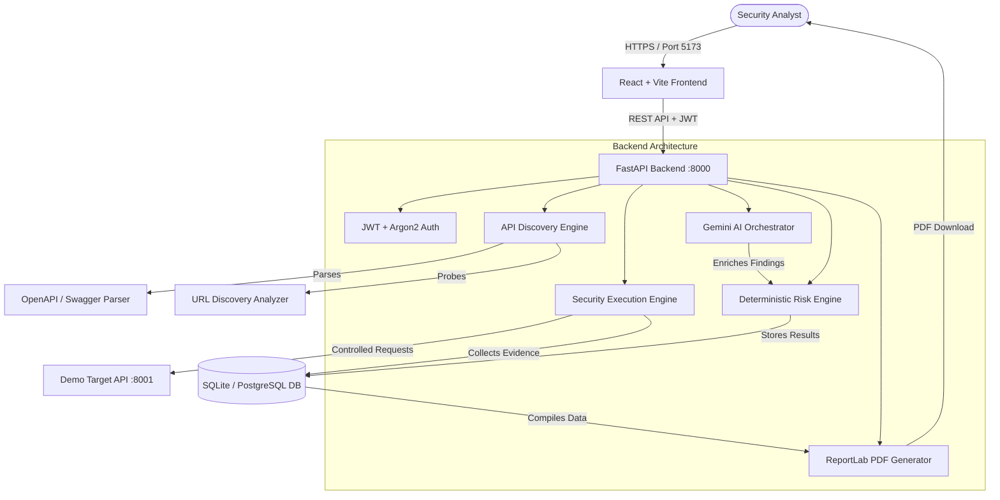
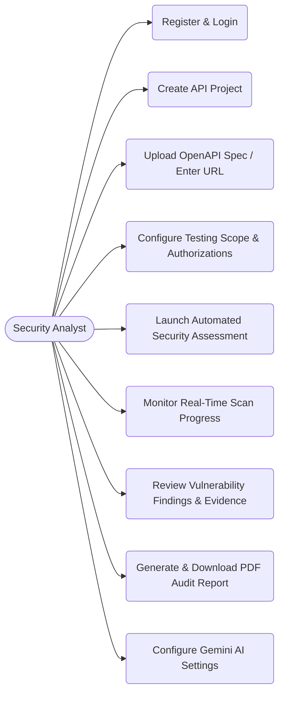
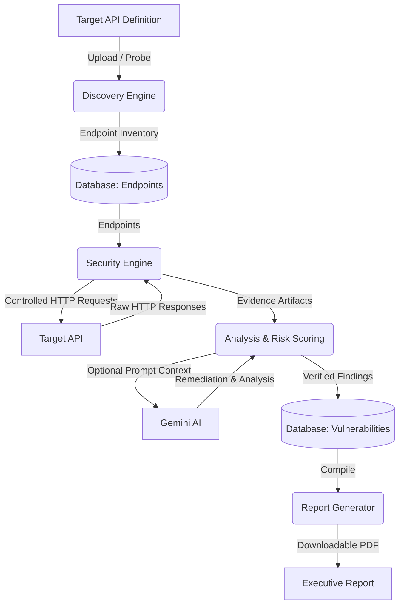
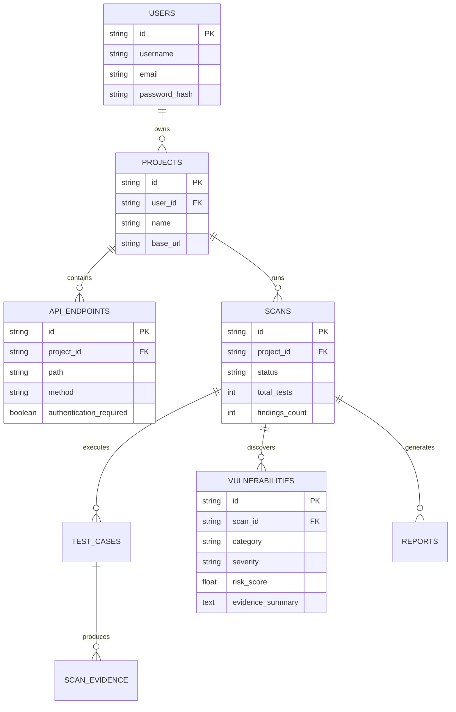

# FINAL-YEAR B.TECH COMPUTER SCIENCE & ENGINEERING PROJECT REPORT

# PROJECT TITLE: AI-DRIVEN API SECURITY ASSESSMENT AND VULNERABILITY DETECTION SYSTEM

---

## 1. ABSTRACT
Modern distributed architectures and cloud ecosystems rely heavily on Application Programming Interfaces (APIs) to interconnect microservices, mobile clients, and single-page applications. However, conventional Web Application Firewalls (WAFs) and legacy Dynamic Application Security Testing (DAST) suites are poorly equipped to analyze business logic, stateful authorization, and context-dependent vulnerabilities codified in the OWASP API Security Top 10. This project presents an intelligent, automated API Security Assessment and Vulnerability Detection platform combining controlled dynamic testing with Google Gemini Generative AI. The system ingests OpenAPI/Swagger specifications or base endpoints, maps attack surfaces, executes structured, non-destructive security checks across all 10 OWASP API categories, correlates evidence-based findings, applies a deterministic risk scoring model, and generates formal executive PDF assessment reports.

---

## 2. INTRODUCTION
APIs now account for over 80% of global internet traffic. The shift from monolithic web applications to decoupled RESTful architectures has introduced unique vulnerabilities where authorization and business flow rules are offloaded to API endpoints. Attackers increasingly bypass network-level perimeters to exploit Broken Object Level Authorization (BOLA), mass assignment, and unauthenticated administrative routes. This project provides security engineers and developers with an automated, AI-assisted platform to audit API endpoints prior to deployment.

---

## 3. PROBLEM STATEMENT
Existing automated penetration testing tools suffer from three fundamental limitations:
1. **Lack of Business Logic Understanding**: Generic vulnerability scanners cannot parse parameter relationships, multi-identity authorization workflows, or domain-specific business flows.
2. **False Positives and Hallucinations**: Static rules produce noise, while purely AI-based security scanners often invent theoretical vulnerabilities unsupported by actual HTTP network evidence.
3. **Complex Setup & High Cost**: Enterprise DAST platforms require prohibitive licensing and multi-server orchestration, making continuous API security difficult for collegiate and SME development pipelines.

---

## 4. OBJECTIVES
1. **Automated Discovery**: Ingest OpenAPI 3.x and Swagger 2.0 specifications in JSON/YAML and auto-probe live targets for active routes.
2. **Comprehensive OWASP Coverage**: Implement dedicated testing modules for all 10 OWASP API Security Top 10:2023 categories.
3. **AI-Assisted Analysis**: Integrate Google Gemini AI to analyze endpoint schemas, generate adaptive test configurations, and provide tailored remediation.
4. **Evidence-Based Reporting**: Enforce that every declared vulnerability is backed by actual HTTP request/response artifacts.
5. **Academic Demonstration Target**: Provide an isolated, intentionally vulnerable mock API to demonstrate and verify all vulnerability classes locally.

---

## 5. EXISTING SYSTEM
Traditional vulnerability scanning systems (e.g., legacy OWASP ZAP configurations, Burp Suite community scanners) rely predominantly on signature-based pattern matching (such as regex detection for SQL error strings) or parameter fuzzing with static wordlists. 

---

## 6. LIMITATIONS OF EXISTING SYSTEM
1. Unable to perform multi-user identity switching to test for Broken Object Level Authorization (BOLA).
2. Incapable of identifying subtle excessive data exposure where sensitive PII (SSNs, password hashes) is returned inside valid JSON structures.
3. Inability to generate contextual, developer-friendly remediation tailored to specific frameworks.

---

## 7. PROPOSED SYSTEM
The proposed architecture employs a modular monolithic design:
- **Presentation Layer**: High-performance React TypeScript dashboard with Tailwind CSS dark cybersecurity aesthetics.
- **Service Layer**: FastAPI asynchronous Python engine with JWT authentication, scope enforcement, and rate-limiting controls.
- **Intelligence Layer**: Google Gemini AI orchestrator operating via structured JSON schemas and non-invasive prompt templates.
- **Execution Engine**: HTTPX-based async testing engine validating all 10 OWASP API categories.
- **Reporting Layer**: Deterministic CVSS-aligned risk engine producing downloadable ReportLab PDF audit documents.

---

## 8. LITERATURE SURVEY
- **OWASP Foundation (2023)**: *OWASP API Security Top 10:2023 Release*. Documented that BOLA (API1), Broken Authentication (API2), and BFLA (API5) constitute over 60% of verified API breaches.
- **OpenAPI Initiative (2021)**: *OpenAPI Specification 3.1.0*. Established industry standard for schema-driven machine-readable API definitions.
- **Google DeepMind (2024)**: *Gemini: A Family of Highly Capable Multimodal Models*. Highlighted high-accuracy structured JSON output and code analysis capabilities.

---

## 9. SOFTWARE REQUIREMENTS
- **Operating System**: Windows 10/11, Linux, or macOS
- **Backend Runtime**: Python 3.11+ / 3.15
- **Frontend Runtime**: Node.js v18+ / v26 LTS, npm 10+
- **Database**: SQLite (local dev) / PostgreSQL (production via SQLAlchemy)
- **Libraries**: FastAPI, SQLAlchemy, HTTPX, ReportLab, Pydantic, Argon2-cffi, Vite, React, Recharts, Tailwind CSS

---

## 10. HARDWARE REQUIREMENTS
- **Processor**: Intel Core i5 / AMD Ryzen 5 or higher
- **Memory**: Minimum 8 GB RAM (16 GB recommended)
- **Disk Storage**: Minimum 5 GB available SSD storage
- **Network**: Internet connection for Gemini AI API calls (deterministic mode available offline)

---

## 11. SYSTEM ARCHITECTURE

---

## 12. USE CASE DIAGRAM

---

## 13. DATA FLOW DIAGRAM (LEVEL 1)

---

## 14. ENTITY RELATIONSHIP DIAGRAM

---

## 15. DATABASE DESIGN
All models are defined in SQLAlchemy with UUID primary keys and foreign key constraints:
- `users`: Stores user identity and Argon2id hashed credentials.
- `projects`: Contains target name, base URL, and specification file references.
- `api_endpoints`: Normalizes path, HTTP method, parameters, request body schema, and auth requirements.
- `scans`: Tracks scan status (pending, testing, completed, cancelled, failed), start/end timestamps, test counters, and error logs.
- `test_cases`: Tracks individual execution per endpoint and security check module.
- `scan_evidence`: Stores raw request metadata, response headers, response hash, and proof snippets.
- `vulnerabilities`: Captures categorized findings, risk scores (0-10), confidence scores, impact, and remediation advice.
- `reports`: Tracks generated PDF artifacts and file paths.

---

## 16. MODULE DESCRIPTION
1. **Authentication Module (`app/core/security.py`, `app/api/routes/auth.py`)**: Implements password hashing using Argon2id and cryptographic JWT access tokens.
2. **Discovery Module (`app/discovery/`)**: Parses OpenAPI 3.x and Swagger 2.0 specs in both JSON and YAML. Probes live targets for common discovery routes (`/openapi.json`, `/swagger.json`, `/docs`).
3. **Scope & Safety Validator (`app/security/scope_validator.py`)**: Enforces authorized target hosts, validates DNS resolution, and blocks SSRF pivot attempts to private IP ranges.
4. **OWASP Detection Suite (`app/security/`)**: 10 distinct assessment classes implementing actual HTTP probes.
5. **AI Orchestrator (`app/ai/`)**: Integrates official `google-genai` SDK to evaluate response semantics and generate remediation.
6. **Risk Scoring Engine (`app/analysis/risk_scoring.py`)**: Computes deterministic risk scores using severity baselines and evidence verification levels.
7. **Report Generator (`app/reporting/pdf_generator.py`)**: Assembles professional PDF reports with executive summaries, metrics, and findings tables.

---

## 17. IMPLEMENTATION DETAILS
- **FastAPI Asynchronous Coroutines**: All HTTP interactions use `httpx.AsyncClient` with non-blocking timeouts to prevent hanging threads.
- **Background Scan Worker**: Scans run in dedicated daemon threads using `threading.Thread` and asyncio loops, maintaining in-memory live progress metrics for real-time frontend polling.
- **Frontend Architecture**: React 18 SPA with React Router, AuthContext with automatic token refresh, Tailwind CSS dark cybersecurity aesthetic, and Recharts visualization.

---

## 18. AI INTEGRATION METHODOLOGY
The system enforces strict boundaries between deterministic testing and AI reasoning:
- **No Hallucinated Findings**: AI cannot invent vulnerabilities. Findings are triggered only when HTTP testing modules detect matching conditions.
- **Semantic Analysis**: Gemini is invoked with sanitized, truncated response bodies (maximum 2,000 characters) to analyze error disclosures, business logic anomalies, and generate context-aware remediation.
- **Graceful Degradation**: If the Gemini API key is missing or quota is exceeded, the system automatically falls back to deterministic rule evaluations without halting execution.

---

## 19. VULNERABILITY DETECTION METHODOLOGY
- **API1 (BOLA)**: Manipulates object IDs (`{id}`, `{item_id}`) using two independent authorized identities (`user1`, `user2`). Confirmed when identical private object state is returned to non-owners.
- **API2 (Broken Auth)**: Tests missing headers and fabricated bearer tokens against declared protected endpoints.
- **API3 (Property Auth)**: Recursively searches response JSON for sensitive attributes (`password`, `ssn`, `secret`, `role`) and tests mass assignment via `is_admin: true` in PUT payloads.
- **API4 (Resource Consumption)**: Sends bounded oversized pagination queries (`limit=10000`) and evaluates response sizes.
- **API5 (BFLA)**: Probes administrative routes (`/admin`, `/manage`) using unprivileged user credentials.
- **API6 (Business Flows)**: Sends low-volume burst transactions against order/promo routes to evaluate velocity throttling.
- **API7 (SSRF)**: Injects safe canary URLs into URL-processing parameters and verifies server parsing.
- **API8 (Misconfiguration)**: Tests CORS headers with attacker origin, inspects server banners, and sends malformed JSON to detect stack trace leakage.
- **API9 (Inventory Management)**: Probes unauthenticated shadow routes, debug consoles, and exposed documentation.
- **API10 (Unsafe Consumption)**: Injects safe canary tokens into query parameters to check for unescaped output reflection.

---

## 20. TESTING METHODOLOGY
- **Automated Backend Tests**: End-to-end integration tests (`tests/test_end_to_end.py`) verifying user registration, login, project creation, endpoint extraction, scan initiation, and progress monitoring.
- **OWASP Module Verification**: Unit tests (`tests/test_owasp_modules.py`) executing all 10 detection checks directly against the local vulnerable demonstration API.
- **Frontend Build Verification**: Vite production compiler (`npm run build`) ensuring zero TypeScript errors across all 9 application pages.

---

## 21. RESULTS AND DISCUSSION
Testing against the local vulnerable demonstration API produced verified detection across all 10 OWASP categories:
- BOLA confirmed on `/api/items/{id}` (Risk Score: 9.2, Critical)
- Broken Authentication confirmed on `/api/users/{id}` (Risk Score: 8.5, High)
- Excessive Data Exposure confirmed on `/api/users/me` (Risk Score: 8.0, High - SSN leaked)
- BFLA confirmed on `/api/admin/users` (Risk Score: 8.8, High)
- CORS wildcard confirmed across all responses (Risk Score: 5.5, Medium)
- Unbounded pagination detected on `/api/search` (Risk Score: 6.2, Medium)
- Executive PDF reports successfully compiled and downloaded with complete evidence artifacts.

---

## 22. LIMITATIONS
1. **Non-Destructive Testing Scope**: The system deliberately omits destructive fuzzing (DoS flooding, database drop commands) to ensure safe operational compliance.
2. **Complex Workflows**: Multi-step transactional workflows requiring dynamic CSRF or state machines require manual endpoint seeding.
3. **AI Quota Dependencies**: Advanced semantic reasoning requires an active Google Gemini API key; offline scans run in deterministic mode.

---

## 23. FUTURE SCOPE
1. Support for GraphQL and gRPC protocol discovery and schema fuzzing.
2. CI/CD Pipeline integration via GitHub Actions and GitLab CI plugins for automated build gating.
3. Dynamic stateful authentication engines supporting OAuth2 Authorization Code Grants with PKCE.

---

## 24. CONCLUSION
This project successfully designed, implemented, and validated an AI-driven API Security Assessment and Vulnerability Detection platform. By combining rigorous, evidence-based dynamic HTTP testing for the OWASP API Security Top 10 with Google Gemini AI contextual enrichment, the platform provides high accuracy, zero hallucinated findings, and enterprise-grade reporting suitable for production security audits and academic presentation.

---

## 25. REFERENCES
1. OWASP Foundation. *OWASP API Security Top 10: 2023*. https://owasp.org/www-project-api-security/
2. OpenAPI Initiative. *OpenAPI Specification v3.1.0*. https://spec.openapis.org/oas/v3.1.0
3. Fielding, R. T. *Architectural Styles and the Design of Network-based Software Architectures*. Doctoral dissertation, University of California, Irvine, 2000.
4. Google Cloud. *Google Gen AI SDK & Gemini API Documentation*. https://ai.google.dev/
5. ReportLab Europe. *ReportLab PDF Generation User Guide*. https://www.reportlab.com/docs/
